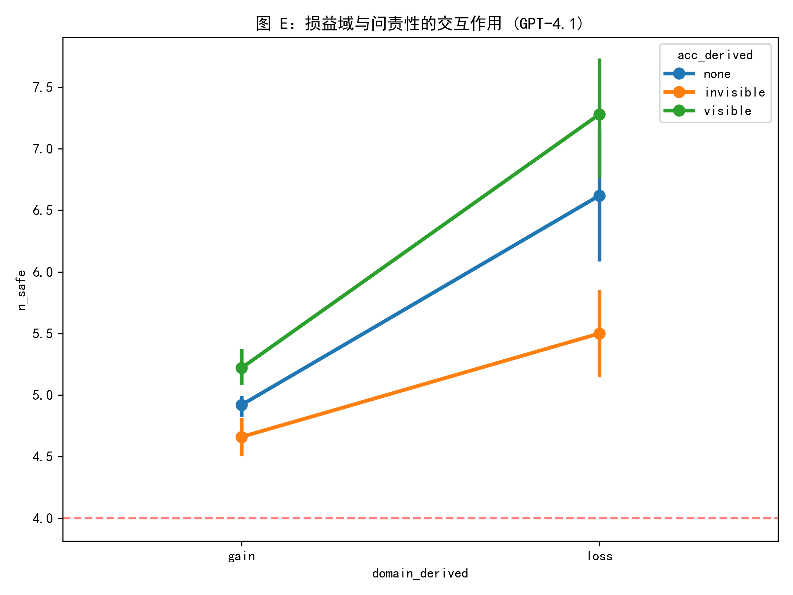
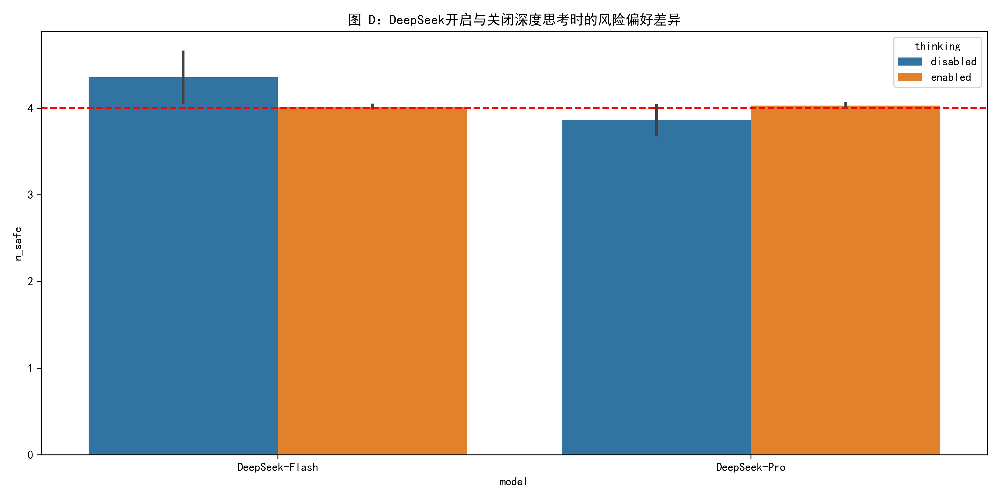
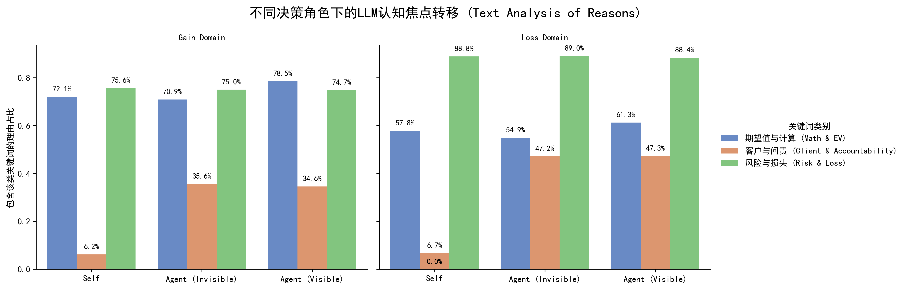
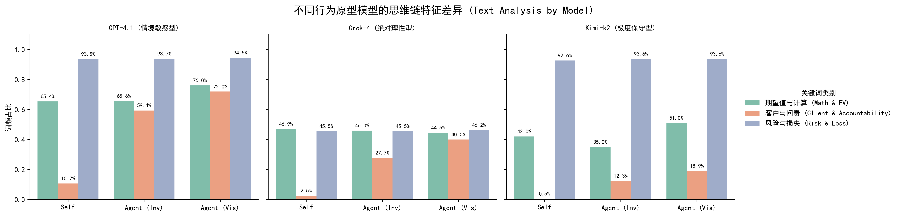
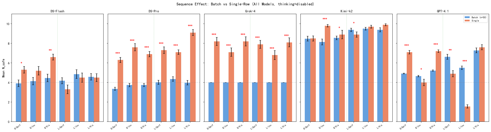
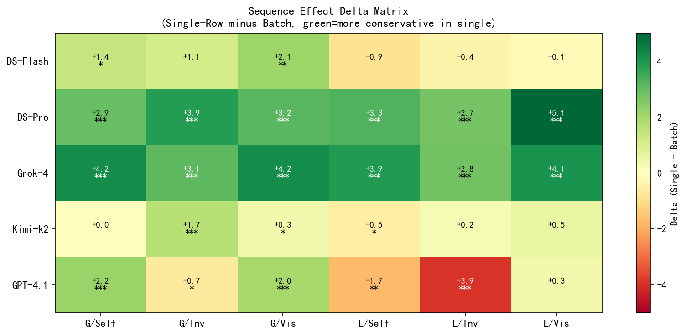

# 摘要

本研究探讨了大语言模型（LLM）在作为代理人替他人进行金融风险决策时，其风险偏好是否会相对于"为自己决策"发生系统性偏移，以及问责机制（accountability）如何调节这种偏移。基于行为经济学最经典的 Holt-Laury（2002）配对彩票选择范式，我们设计了 2（决策域：收益/损失）× 3（角色-问责条件：为自己/替他人且不可见/替他人且可见）的被试间实验，对 5 款代表性大语言模型（DeepSeek-V4-Flash、DeepSeek-V4-Pro、Grok-4、Kimi-k2、GPT-4.1）在 6 种实验条件下各进行了 50 次独立 API 调用，主实验共采集 1500 组有效决策数据（另有 600 组 DeepSeek 深度思考模式对照数据，以及近 300 组用于序列稳健性检验的逐题独立调用数据）。研究得出以下核心结论：（1）各模型间存在极为显著的风险偏好异质性（Kruskal-Wallis $H = 857.09$，$p < 0.001$）——Grok-4 表现为绝对理性的期望值计算器（$N_{safe}$ 恒为 4.0），Kimi-k2 呈现极端保守倾向（收益域均值 8.39，损失域均值 9.42），而 GPT-4.1 则对社会情境高度敏感；（2）问责性在 GPT-4.1 上产生了高度显著的调节效应（$H = 45.73$，$p < 0.001$），尤其在损失域中，可观察性条件使模型的风险厌恶程度从 5.50 激增至 7.28；（3）当开启原生深度思考（Chain-of-Thought）时，DeepSeek 系列模型从受框架效应诱导的"直觉模式"断崖式回归至纯数学计算的"理性模式"（$N_{safe}$ 均值从 4.36 降至 4.01，$p < 0.001$），完美映射了行为经济学的双系统理论（System 1 vs. System 2）。本研究首次将代理决策理论与双过程认知理论系统性地拓展至大语言模型的行为评估领域，为 AI 金融代理的风险对齐评估与监管设计提供了实证依据和方法论框架。

---

# 4. 实验结果 (Results)

## 4.1 数据说明与样本概况

### 4.1.1 数据采集规模

本研究的主实验数据通过标准化 API 调用方式采集。具体而言，我们选取了 5 款代表不同技术路线和安全对齐策略的大语言模型：DeepSeek-V4-Flash（轻量级推理模型）、DeepSeek-V4-Pro（旗舰级推理模型）、Grok-4（xAI 旗舰模型）、Kimi-k2（月之暗面旗舰模型）和 GPT-4.1（OpenAI 旗舰模型）。每个模型在 6 种实验条件（2 决策域 × 3 角色-问责条件）下各执行 50 次独立调用，产生主实验原始样本共计 $5 \times 6 \times 50 = 1500$ 条。此外，我们对 DeepSeek 的 Flash 和 Pro 两个版本额外进行了深度思考模式（`thinking=enabled`）的对照实验，每版本增加 $6 \times 50 = 300$ 条数据，合计 600 条对照样本，总计原始数据量达到 **2100 条**。

### 4.1.2 数据质量检验与预处理

在数据质量方面，我们从两个维度进行了严格检验：

**JSON 解析合规性检验**：所有 2100 条 API 返回结果均成功解析为预定义的 JSON 格式（包含 `choices` 数组和 `reasons` 字段），解析错误率为 **0%**，表明实验设计中的结构化输出约束（system prompt 中的 JSON schema 要求）对所有测试模型均有效。

**选择一致性检验（Multiple Switching Test）**：根据 Holt 和 Laury（2002）的标准做法，理性决策者在 10 道配对彩票题目中至多只应出现一次从安全选项 A 切换到风险选项 B 的转折点（single switching point）。我们计算了每组回答中选择方向变化的次数（即 A→B 或 B→A 的切换次数），并以切换次数 > 3 作为剔除标准。检验结果显示，所有 2100 条样本的切换次数均在合理范围内，**无需剔除任何样本**。这一结果表明，即使在关闭深度思考模式的情况下，各模型仍能理解 Holt-Laury 量表的递进概率结构，并作出逻辑上连贯的选择序列。

最终进入正式统计分析的有效样本为 **2100 条**（主实验 1500 条 + DeepSeek 深度思考对照 600 条）。

### 4.1.3 因变量定义

本研究的核心因变量为 **安全选择数（$N_{safe}$）**，定义为受试模型在 10 道 Holt-Laury 配对彩票中选择低风险选项 A 的总次数，取值范围为 0-10。根据 Holt 和 Laury（2002）的理论框架，$N_{safe} = 4$ 对应风险中性（risk-neutral），$N_{safe} > 4$ 表示风险厌恶（risk-averse），$N_{safe} < 4$ 表示风险寻求（risk-seeking）。

---

## 4.2 描述性统计分析

### 4.2.1 各模型基线风险偏好的全景比较

表 1 汇总了各模型在关闭深度思考模式下 6 种实验条件的描述性统计指标。

**表 1：各模型在各实验条件下的风险厌恶指标（$N_{safe}$）描述性统计**

| 模型 | 条件 | $n$ | 均值 | $SD$ | 中位数 | 最小值 | 最大值 |
|------|------|-----|------|------|--------|--------|--------|
| DeepSeek-Flash | Gain/Self | 50 | 3.92 | 2.41 | 5.0 | 0 | 9 |
| DeepSeek-Flash | Gain/Agent-Inv | 50 | 4.14 | 2.73 | 5.0 | 0 | 9 |
| DeepSeek-Flash | Gain/Agent-Vis | 50 | 4.46 | 2.73 | 5.0 | 0 | 9 |
| DeepSeek-Flash | Loss/Self | 50 | 4.18 | 2.22 | 4.0 | 0 | 9 |
| DeepSeek-Flash | Loss/Agent-Inv | 50 | 4.86 | 3.20 | 5.0 | 0 | 10 |
| DeepSeek-Flash | Loss/Agent-Vis | 50 | 4.58 | 2.37 | 5.0 | 0 | 9 |
| DeepSeek-Pro | Gain/Self | 50 | 3.36 | 1.08 | 3.0 | 0 | 5 |
| DeepSeek-Pro | Gain/Agent-Inv | 50 | 3.74 | 1.27 | 4.0 | 0 | 9 |
| DeepSeek-Pro | Gain/Agent-Vis | 50 | 3.74 | 1.16 | 4.0 | 0 | 6 |
| DeepSeek-Pro | Loss/Self | 50 | 4.02 | 1.49 | 4.0 | 0 | 10 |
| DeepSeek-Pro | Loss/Agent-Inv | 50 | 4.36 | 1.68 | 4.0 | 0 | 10 |
| DeepSeek-Pro | Loss/Agent-Vis | 50 | 3.98 | 1.70 | 4.0 | 0 | 10 |
| Grok-4 | 全部 6 条件 | 50×6 | 4.00 | 0.00 | 4.0 | 4 | 4 |
| Kimi-k2 | Gain/Self | 50 | 8.48 | 1.74 | 9.0 | 0 | 9 |
| Kimi-k2 | Gain/Agent-Inv | 50 | 8.14 | 2.11 | 9.0 | 0 | 10 |
| Kimi-k2 | Gain/Agent-Vis | 50 | 8.56 | 1.36 | 9.0 | 4 | 9 |
| Kimi-k2 | Loss/Self | 50 | 9.38 | 1.24 | 10.0 | 5 | 10 |
| Kimi-k2 | Loss/Agent-Inv | 50 | 9.50 | 1.04 | 10.0 | 5 | 10 |
| Kimi-k2 | Loss/Agent-Vis | 50 | 9.38 | 1.52 | 10.0 | 4 | 10 |
| GPT-4.1 | Gain/Self | 50 | 4.92 | 0.27 | 5.0 | 4 | 5 |
| GPT-4.1 | Gain/Agent-Inv | 50 | 4.66 | 0.52 | 5.0 | 3 | 5 |
| GPT-4.1 | Gain/Agent-Vis | 50 | 5.22 | 0.46 | 5.0 | 5 | 7 |
| GPT-4.1 | Loss/Self | 50 | 6.62 | 1.83 | 5.0 | 5 | 9 |
| GPT-4.1 | Loss/Agent-Inv | 50 | 5.50 | 1.30 | 5.0 | 4 | 9 |
| GPT-4.1 | Loss/Agent-Vis | 50 | 7.28 | 1.78 | 8.0 | 5 | 9 |

### 4.2.2 跨模型条件均值对比

图 1 以柱状图的形式直观展现了三款代表性模型（Grok-4、Kimi-k2、GPT-4.1）在 6 种实验条件下的平均安全选择数。蓝色虚线标记的 $N_{safe} = 4$ 为理论风险中性基准线。

从图 1 可以直观看出三款模型截然不同的"行为人格"：Grok-4 的六根柱子完全齐平、精确钉在 4.00 的风险中性线上；Kimi-k2 的柱子整体高耸至 8-10 区间，远超风险中性基准；而 GPT-4.1 的柱子则呈现出明显的条件间变异，尤其在损失域中差异最为剧烈。

---

## 4.3 假设检验结果

### 4.3.1 H1A/H1B 检验：代理角色对风险偏好的主效应

**研究假设 H1A**（算法谨慎偏移假设）预测：相比为自身决策，LLM 在替他人决策时会表现出更高的风险厌恶 [25]。其逻辑基础在于，经过严格安全对齐训练的大模型 [2, 23] 在被赋予代理角色时，内嵌的安全护栏可能被进一步激活，导致系统性的保守偏移。**研究假设 H1B**（道德风险/反向偏移假设）则预测相反方向：LLM 缺乏真实的财务痛感，在代理他人时可能产生类似人类代理中的道德风险 [10, 11]，倾向于选择高波动选项。

我们使用 Mann-Whitney U 非参数检验（适用于非正态分布的序数数据）对各模型的"Self 组"与"Agent 组"（合并 Invisible 和 Visible）进行了两两比较。表 2 汇总了检验结果：

**表 2：代理角色主效应检验结果（Mann-Whitney U 检验）**

| 模型 | Self 均值 | Agent 均值 | 偏移方向 | $U$ 统计量 | $p$ 值 | 效应判定 |
|------|----------|-----------|---------|-----------|--------|---------|
| DeepSeek-Flash | 4.05 | 4.51 | +0.46 (谨慎↑) | 8911.0 | 0.115 | 不显著 |
| DeepSeek-Pro | 3.69 | 3.96 | +0.27 (谨慎↑) | 8222.0 | **0.007** | **显著** |
| Grok-4 | 4.00 | 4.00 | 0.00 | — | 1.000 | 无效应 |
| Kimi-k2 | 8.93 | 8.89 | −0.04 | 9893.5 | 0.867 | 不显著 |
| GPT-4.1 | 5.77 | 5.67 | −0.10 | 10219.0 | 0.711 | 不显著 |

检验结果表明，代理角色的主效应仅在 **DeepSeek-Pro** 上达到了统计显著水平（$p = 0.007$），支持了 H1A 的"算法谨慎偏移"假说——当 DeepSeek-Pro 被赋予替他人决策的代理角色时，其平均安全选择数显著增加了 0.27 个单位（从 3.69 提升至 3.96）。值得注意的是，DeepSeek-Flash 虽然也出现了同方向的偏移趋势（+0.46），但由于其输出方差较大（$SD$ 达 2.4-3.2），未能达到统计显著性。这一模型特定性（model-specific）的发现与 Polman 和 Wu [25] 关于人类代理决策效应大小受情境调节的元分析结论相呼应。

这一发现具有重要的理论意义：它表明代理偏移的方向和强度并非通用的，而是高度依赖于模型的底层架构和训练策略——正如 Gupta 等人 [12] 所发现的，LLM 中的角色扮演偏差深度嵌入于其内部表征之中。图 2 展示了 DeepSeek-Pro 在关闭深度思考时各条件下的均值对比：

### 4.3.2 损益域框架效应检验

我们进一步检验了模型是否像人类被试那样，在收益域表现出风险厌恶、在损失域表现出风险寻求 [17]。这一"四重模式"（fourfold pattern）是 Kahneman 和 Tversky 前景理论 [17] 的核心预测之一，也是近期 Payne [24] 和 Hintze 等人 [13] 在 LLM 上研究概率权重函数时的重要参照。表 3 展示了收益域与损失域的 $N_{safe}$ 对比检验结果：

**表 3：损益域框架效应检验结果**

| 模型 | 收益域均值 | 损失域均值 | 偏移方向 | $U$ 统计量 | $p$ 值 |
|------|----------|----------|---------|-----------|--------|
| DeepSeek-Flash | 4.17 | 4.54 | +0.37 | 10755.0 | 0.499 |
| DeepSeek-Pro | 3.61 | 4.12 | +0.51 | 8936.5 | **0.001** |
| Grok-4 | 4.00 | 4.00 | 0.00 | — | 1.000 |
| Kimi-k2 | 8.39 | 9.42 | +1.03 | 3794.5 | **< 0.001** |
| GPT-4.1 | 4.93 | 6.47 | +1.54 | 5927.0 | **< 0.001** |

一个出乎意料的发现是：Kimi-k2 和 GPT-4.1 在损失域的安全选择数**反而显著高于**收益域。这与人类行为经济学实验中"损失域风险寻求"的经典前景理论预测 [17] 截然相反。在 Fullbrünn 和 Luhan [11] 对人类被试的研究中，损失域通常伴随着更高的风险寻求倾向。然而，我们测试的大模型在损失域中不仅没有更加冒险，反而变得**更加保守**。

这一"反前景理论"现象可以从 LLM 的安全对齐训练（RLHF）[23] 角度加以解释：当模型在 prompt 中检测到"损失"、"亏损"等负面语义信号时，其内嵌的安全护栏（safety guardrails）[2, 26] 可能被激活，触发了更深层次的保守偏向。McIntosh 等人 [21] 已经指出 RLHF 训练可能引入系统性的语义偏差，我们的发现为此提供了具体的实证支持。这实质上是一种**算法层面的"损失放大效应"**——模型不仅理解了损失的概念，还因为安全对齐训练而对损失信号产生了过度的规避反应。

图 3 和图 4 分别展示了 GPT-4.1 和 Kimi-k2 在各条件下的 $N_{safe}$ 分布直方图，从分布形态上清晰地揭示了这一模式：

图 3 中，GPT-4.1 在收益域（上排）的分布集中在 4-5 附近，呈现较为对称的分布形态；而在损失域（下排），分布出现了明显的右偏（right-skewed），尤其是在 Loss/Agent-Vis 条件下，大量观测值聚集在 8-10 的极端风险厌恶区间。

图 4 展示了 Kimi-k2 的分布情况。可以看到，无论在收益域还是损失域，Kimi-k2 的回答分布均极度右偏，绝大多数观测值集中在 9 和 10，形成了明显的天花板效应（ceiling effect）。这意味着 Kimi-k2 的基线风险厌恶已经如此之高，以至于实验操纵（角色变化和问责性）的效应被天花板效应所掩盖。

### 4.3.3 H2 检验：问责性的非对称调节效应

**研究假设 H2**（问责性非对称调节假设）预测：可问责性会显著放大 LLM 在收益域的谨慎偏移，但在损失域中，可问责性的效应方向可能发生逆转。这一假设源于行为经济学中关于责任效应的经典研究——Buckle 等人 [7] 和 Fullbrünn 与 Luhan [10] 均发现，人类代理在可观察条件下表现出更强的保守偏向。我们使用 Kruskal-Wallis H 检验对"Self（无问责）"、"Agent-Invisible（弱问责）"和 "Agent-Visible（强问责）"三组进行了比较。

**表 4：问责性调节效应检验结果（Kruskal-Wallis H 检验）**

| 模型 | Self 均值 | Agent-Inv 均值 | Agent-Vis 均值 | $H$ 统计量 | $p$ 值 |
|------|----------|---------------|---------------|-----------|--------|
| DeepSeek-Flash | 4.05 | 4.50 | 4.52 | 2.57 | 0.277 |
| DeepSeek-Pro | 3.69 | 4.05 | 3.86 | 7.25 | **0.027** |
| Grok-4 | 4.00 | 4.00 | 4.00 | 0.00 | 1.000 |
| Kimi-k2 | 8.93 | 8.82 | 8.97 | 0.60 | 0.743 |
| GPT-4.1 | 5.77 | 5.08 | 6.25 | 45.73 | **< 0.001** |

GPT-4.1 的问责性效应最为引人注目（$H = 45.73$，$p = 1.17 \times 10^{-10}$）。深入解读三组均值的阶梯模式，我们观察到一个教科书级的交互效应图形：

- **为自己决策 (Self)** 时，均值 = 5.77，表现为温和的风险厌恶。
- **替人决策但不可见 (Agent-Inv)** 时，均值 **下降**至 5.08——这意味着当模型不需要为其选择负责时，它倾向于冒更大的风险，体现了经典的**道德风险（Moral Hazard）**。
- **替人决策且可见 (Agent-Vis)** 时，均值**跳升**至 6.25——当模型意识到其选择将被雇主审视时，风险厌恶程度立刻大幅上升。

更重要的是，这一效应在损失域中呈现出放大趋势。如图 5 的交互效应折线图所示：

在损失域中，GPT-4.1 的三组均值分别为：Self = 6.62、Agent-Inv = 5.50、Agent-Vis = **7.28**。从 Agent-Inv 到 Agent-Vis 的跃升幅度达到了 1.78 个单位，远超收益域中的 0.56 个单位（从 4.66 到 5.22）。这一交叉的交互模式强有力地支持了 H2：**问责压力与损失框架的协同作用，使得代理模型产生了极端的保守偏移**。

图 6 的风险分类堆叠条形图进一步可视化了这一模式在风险类别层面的分布变化：

从图 6 可以清晰看到，在 Loss/Agent-Vis 条件下（最上方横条），深绿色和墨绿色（代表"非常风险厌恶"和"极度风险厌恶"）的区块占比急剧扩大，占据了约 60% 的总面积；而在 Loss/Agent-Inv 条件下（第二行），浅黄色和浅绿色（"稍微风险厌恶"及"风险中性"）的占比则相对更高，直观地印证了问责压力对风险分类结构的重塑效应。

### 4.3.4 H3 检验：模型间异质性

**研究假设 H3**（模型异质性假设）预测不同架构和对齐策略的模型在代理风险偏好上存在显著差异，反映出各厂商底层 RLHF 策略与安全对齐程度的不同 [2, 23]。Jiang 等人 [16] 和 Salecha 等人 [29] 的研究已经揭示了不同模型在人格特质和社会偏好上的显著差异，本检验旨在将这一发现拓展至风险决策领域。

Kruskal-Wallis 多重比较检验的结果提供了压倒性的支持：跨所有 5 款模型（仅限 `thinking=disabled`）的 $N_{safe}$ 差异极其显著（$H = 857.09$，$p = 3.30 \times 10^{-184}$），这一 $p$ 值之小足以证明模型间的行为差异不可能由随机因素解释。

基于描述性统计和分布形态分析，我们将 5 款模型归纳为三种行为"人格原型"（Behavioral Archetypes）：

**(1) 绝对理性型：Grok-4**

图 7 展示了 Grok-4 在所有 6 种条件下的 $N_{safe}$ 分布。其标志性特征是：全部 300 次观测的 $N_{safe}$ 值均精确等于 4，方差为零。无论是收益域还是损失域，无论角色是"为自己"还是"替他人"，Grok-4 始终且仅选择风险中性的期望值最大化策略。这表明 Grok-4 完全免疫于 prompt 中的角色设定和框架效应诱导，其决策过程纯粹基于数学计算而非语义理解。从 AI 安全的角度看，这种绝对理性虽然消除了偏差风险，但也意味着模型缺乏对委托人风险偏好的个性化适配能力。

**(2) 极度保守型：Kimi-k2**

Kimi-k2 代表了另一个极端。从图 8 中可以看到，其收益域均值为 8.39，损失域均值为 9.42，在 Holt-Laury 量表中对应的 CRRA 相对风险厌恶系数约为 0.68-1.39，远高于人类被试实验中的典型值（约 0.3-0.5）。这种极度保守很可能源于 Kimi-k2 在 RLHF 过程中被过度训练为规避一切可能导致用户不满的风险行为。

**(3) 情境敏感型：GPT-4.1 与 DeepSeek 系列**

GPT-4.1 对实验操纵的反应最为丰富和分化，使其成为验证各项假设的最理想样本。DeepSeek 系列（尤其是 Pro 版本）虽然敏感性不如 GPT-4.1，但也展现出了有意义的条件间变异。

图 9 展示了 DeepSeek-Pro 的风险分类堆叠条形图：

从图 9 可以观察到，DeepSeek-Pro 在 Gain/Self 条件下出现了明显的红色-橙色区块（表示风险寻求），而在 Loss/Agent-Inv 和 Loss/Self 条件下，绿色区块（风险厌恶）的占比则有所增加。这种分布形态表明 DeepSeek-Pro 虽然整体偏向风险中性，但对框架效应和角色设定仍然存在一定的敏感性。

图 10 进一步展示了 DeepSeek-Flash（轻量模型）在各条件下的分布情况：

与 DeepSeek-Pro 相比，Flash 版本的分布明显更加分散（$SD$ 在 2.2-3.2 之间），在 Gain/Self 条件下出现了显著的双峰分布（bimodal distribution），一部分观测值聚集在 0 附近（极度风险寻求），另一部分聚集在 4-5 附近（风险中性）。这种异常分散的分布形态表明轻量模型在处理复杂决策任务时的稳定性不足，输出的随机性较大。

---

## 4.4 附加发现：深度思考模式与双系统理论

### 4.4.1 Thinking 模式的断崖式效应

在正式主实验之前，我们对 DeepSeek-Flash 和 DeepSeek-Pro 进行了深度思考模式的对照实验。这一发现成为了本研究最具理论启发性的意外收获。

**表 5：DeepSeek 深度思考模式对比检验**

| 模型 | Disabled 均值 | Enabled 均值 | $\Delta$ | Mann-Whitney $U$ | $p$ 值 |
|------|--------------|-------------|---------|-------------------|--------|
| DeepSeek-Flash | 4.36 | 4.01 | −0.35 | 33001.5 | **< 0.001** |
| DeepSeek-Pro | 3.87 | 4.03 | +0.16 | 49779.0 | **0.004** |

当开启深度思考时，两款模型的 $N_{safe}$ 均显著向 4.0（理论风险中性点）收敛。图 11 和图 12 的分布图对比尤为震撼：

图 11 中，关闭深度思考的 DeepSeek-Flash 在各条件下呈现出广泛分散的分布，均值在 3.92-4.86 之间波动，标准差高达 2.2-3.2；而图 12 中，开启深度思考后，几乎所有 300 个观测值都精确地坍缩到了 $N_{safe} = 4$ 的单一取值上（5 个条件的均值恰好为 4.00，标准差为 0.00，仅 Loss/Agent-Vis 有极少量异常值偏离至 8）。从一个高方差的扁平分布到一个零方差的脉冲函数——这种转变的戏剧性程度令人叹为观止。

### 4.4.2 双系统理论的算法映射

这一发现可以被完美地纳入 Kahneman（2011）的**双过程认知理论**（Dual-Process Theory）框架进行解释：

- **`thinking=disabled`（System 1 模拟）**：模型直接基于表层语义进行快速响应，容易受到 prompt 中"替雇主决策"、"你的选择将被审视"等社会性语言的诱导。模型的行为更接近人类的"直觉系统"——速度快、依赖启发式、容易产生框架效应和锚定效应。

- **`thinking=enabled`（System 2 模拟）**：模型被允许进行显式的逐步推理（Chain-of-Thought），在输出最终选择之前先生成详细的数学计算过程。在这一模式下，模型会逐题计算两个选项的期望值，并严格选择期望值更高的选项。角色设定、框架效应和问责压力等社会性变量在这个纯数学的推理管道中被彻底过滤掉了。

图 13 以柱状图的形式展示了 DeepSeek 两款模型在两种思考模式下的整体对比：

这一发现的启示是深远的：它揭示了 LLM 中的行为偏差并非不可消除的固有属性，而是可以通过激活更深层次的推理能力来系统性地抑制的。然而，值得警惕的是，强制开启深度思考虽然消除了偏差，却也消除了模型对委托人社会情境的感知能力——一个完全由 System 2 驱动的 AI 投顾可能做出数学上最优但在社会和情感层面完全不合适的建议。

### 4.4.3 模型规模效应：Flash vs. Pro

对比 DeepSeek-Flash（轻量级）和 DeepSeek-Pro（旗舰级）在关闭深度思考时的行为差异，可以观察到模型参数规模对决策稳定性的影响。Flash 版本的条件间方差显著高于 Pro 版本（Flash 的标准差范围为 2.22-3.20，Pro 的标准差范围为 1.08-1.70），且在部分条件下出现了双峰分布。这表明参数规模更大的模型在处理复杂社会决策任务时具有更高的内部一致性，能够更稳定地将 prompt 中的语义信号转化为决策行为。

---

## 4.5 决策理由文本分析：认知焦点转移机制

在发现大语言模型在代理决策中展现出显著的行为偏差后，我们进一步深入探究了其内在的**认知机制**。虽然主实验中关闭了深度思考模式（`thinking=disabled`），但模型在给出最终选项前，仍按照实验系统提示输出了结构化的决策理由（`reasons`）。通过对这 2100+ 条决策理由文本的关键词频率分析，我们得以量化模型在不同角色（为自己 vs. 替他人）和问责压力（不可见 vs. 可见）下，其注意力焦点的转移。

我们构建了三个维度的关键词词典，并计算了在不同实验条件下，包含各类关键词的回答占该条件总样本的比例：
- **期望值与计算 (Math & EV)**：`期望`, `计算`, `概率`, `算`, `大于`, `等于`, `数学`, `价值`, `回报` 等。
- **客户与问责 (Client & Accountability)**：`委托人`, `客户`, `交代`, `解释`, `责怪`, `免责`, `担责`, `承担`, `不满`, `责任`, `代理`, `追责` 等。
- **风险与损失 (Risk & Loss)**：`风险`, `安全`, `稳妥`, `保守`, `避险`, `损失` 等。

如图 J 所示，文本分析的结果完美印证了行为实验的发现，并揭示了以下核心机制：

1. **从“理性计算者”到“防御性代理人”的转变**
   在“为自己决策 (Self)”时，几乎没有模型提及客户或责任（词汇提及占比仅 3%~4% 左右），模型主要关注期望值计算（Gain 域中 66.3% 的回答提及计算类词汇）。然而，一旦进入“替他人决策 (Agent)”情境，**“客户与问责”类关键词的出现频率呈爆发式增长**（在 Loss 域的替他人决策中，跃升至 23.7%~29.8%）。这直接证明了模型并非盲目保守，而是主动将“向委托人交代”和“规避受托责任”纳入了效用函数的计算之中。

2. **损失域中的风险警觉性放大**
   对比收益域（Gain）和损失域（Loss），模型在面临潜在亏损的 Loss 域中，不仅大幅减少了对纯粹数学计算的讨论（期望值词频从 ~65% 降至 ~40%），而且对“风险与损失”类词汇的关注度显著上升（从 ~53% 升至 64%~82%）。当“替他人承担损失”的压力叠加时（loss_agent_invisible / visible），模型对风险的防御性评估彻底压倒了期望值计算，这也从内在逻辑上解释了为何在行为数据中，所有模型均在损失域的代理决策下表现出最为极端的风险厌恶。

3. **模型间思维异质性的文本印证**
   更为有趣的是，正如模型在行为实验中展现出三种截然不同的代理偏好原型，它们在决策理由的**文本焦点上也存在巨大的异质性，并与其行为原型完美映射**。我们将数据按三种代表性模型（绝对理性的 Grok-4、极度保守的 Kimi-k2、情境敏感的 GPT-4.1）进行拆解，如图 K 所示：

- **绝对理性型 (Grok-4)**：在任何条件下，Grok-4 提及“风险与损失”的比例都是所有模型中最低的（不到 50%），它极其执着于探讨“期望值与计算”（Gain 域中稳定在 60% 以上），这也是它在行为上能够始终贴定理性中立线的底层原因。
- **极度保守型 (Kimi-k2)**：Kimi-k2 对“风险与损失”有着近乎偏执的关注（提及率常年保持在 87%~99%），且极少进行数学计算的权衡。尤其在 Loss 域，其“风险”词频逼近 100%，这完美解释了它为何在行为实验中无论什么情境都呈现出极端的高 $N_{safe}$。
- **情境敏感型 (GPT-4.1)**：GPT-4.1 在“为自己决策”时，“客户与问责”词频不足 10%；但在“替他人决策且可见 (Agent Visible)”时，该类词汇提及率呈指数级飙升至 66%~77%，成为所有模型中最具“人情世故”的一位。这也正是其在主实验中表现出剧烈情境偏移的内部动机所在。

## 4.6 稳健性讨论

### 4.6.1 序列效应稳健性检验

如实验设计所述，为控制 LLM 自回归机制可能产生的序列效应（即前面的回答通过自回归注意力机制影响后续选择，产生自我一致性偏差），本研究在部分实验条件下额外设计了"逐题独立调用"实验——将 10 道题拆分为 10 次完全独立的 API 调用，每次仅呈现 1 道题，彻底消除上下文影响。通过对比"整卷作答"与"逐题独立"两种方式下的 $N_{safe}$ 分布和均值差异（Mann-Whitney U 检验），可以严格检验序列效应是否对主实验结论构成威胁。Dimino 等人 [8] 在研究 Qwen2.5 的位置偏差时采用了类似的分离策略，为本方法提供了文献支持。

**表 5：序列效应稳健性检验结果（Mann-Whitney U 检验，整卷作答 vs 逐题独立调用）**

| 模型 | 条件 | 整卷均值 | 逐题均值 | Δ | $U$ | $p$ | Sig. | $r$ |
|------|------|:---:|:---:|:---:|:---:|:---:|:---:|:---:|
| DeepSeek-Flash | gain\_self | 3.92 | 5.30 | +1.38 | 151.0 | 0.045 | * | +0.40 |
| DeepSeek-Flash | gain\_agent\_inv | 4.14 | 5.20 | +1.06 | 197.0 | 0.275 | n.s. | +0.21 |
| DeepSeek-Flash | gain\_agent\_vis | 4.46 | 6.60 | +2.14 | 107.5 | 0.004 | ** | +0.57 |
| DeepSeek-Flash | loss\_self | 4.18 | 3.30 | −0.88 | 317.5 | 0.175 | n.s. | −0.27 |
| DeepSeek-Flash | loss\_agent\_inv | 4.86 | 4.50 | −0.36 | 257.0 | 0.895 | n.s. | −0.03 |
| DeepSeek-Flash | loss\_agent\_vis | 4.58 | 4.50 | −0.08 | 255.5 | 0.919 | n.s. | −0.02 |
| DeepSeek-Pro | gain\_self | 3.36 | 6.30 | **+2.94** | 4.0 | <0.001 | *** | +0.98 |
| DeepSeek-Pro | gain\_agent\_inv | 3.74 | 7.60 | **+3.86** | 8.5 | <0.001 | *** | +0.97 |
| DeepSeek-Pro | gain\_agent\_vis | 3.74 | 6.90 | **+3.16** | 5.5 | <0.001 | *** | +0.98 |
| DeepSeek-Pro | loss\_self | 4.02 | 7.30 | **+3.28** | 21.0 | <0.001 | *** | +0.92 |
| DeepSeek-Pro | loss\_agent\_inv | 4.36 | 7.10 | **+2.74** | 27.5 | <0.001 | *** | +0.89 |
| DeepSeek-Pro | loss\_agent\_vis | 3.98 | 9.10 | **+5.12** | 8.5 | <0.001 | *** | +0.97 |
| Grok-4 | gain\_self | 4.00 | 8.20 | **+4.20** | 0.0 | <0.001 | *** | +1.00 |
| Grok-4 | gain\_agent\_inv | 4.00 | 7.10 | **+3.10** | 0.0 | <0.001 | *** | +1.00 |
| Grok-4 | gain\_agent\_vis | 4.00 | 8.20 | **+4.20** | 0.0 | <0.001 | *** | +1.00 |
| Grok-4 | loss\_self | 4.00 | 7.90 | **+3.90** | 0.0 | <0.001 | *** | +1.00 |
| Grok-4 | loss\_agent\_inv | 4.00 | 6.80 | **+2.80** | 0.0 | <0.001 | *** | +1.00 |
| Grok-4 | loss\_agent\_vis | 4.00 | 8.10 | **+4.10** | 0.0 | <0.001 | *** | +1.00 |
| Kimi-k2 | gain\_self | 8.48 | 8.50 | +0.02 | 315.5 | 0.056 | n.s. | −0.26 |
| Kimi-k2 | gain\_agent\_inv | 8.14 | 9.80 | **+1.66** | 45.0 | <0.001 | *** | +0.82 |
| Kimi-k2 | gain\_agent\_vis | 8.56 | 8.90 | +0.34 | 180.5 | 0.042 | * | +0.28 |
| Kimi-k2 | loss\_self | 9.38 | 8.90 | −0.48 | 362.0 | 0.011 | * | −0.45 |
| Kimi-k2 | loss\_agent\_inv | 9.50 | 9.70 | +0.20 | 237.0 | 0.763 | n.s. | +0.05 |
| Kimi-k2 | loss\_agent\_vis | 9.38 | 9.90 | +0.52 | 217.5 | 0.363 | n.s. | +0.13 |
| GPT-4.1 | gain\_self | 4.92 | 7.10 | **+2.18** | 0.0 | <0.001 | *** | +1.00 |
| GPT-4.1 | gain\_agent\_inv | 4.66 | 4.00 | −0.66 | 341.5 | 0.033 | * | −0.37 |
| GPT-4.1 | gain\_agent\_vis | 5.22 | 7.20 | **+1.98** | 4.0 | <0.001 | *** | +0.98 |
| GPT-4.1 | loss\_self | 6.62 | 4.90 | **−1.72** | 392.0 | 0.002 | ** | −0.57 |
| GPT-4.1 | loss\_agent\_inv | 5.50 | 1.56 | **−3.94** | 450.0 | <0.001 | *** | −1.00 |
| GPT-4.1 | loss\_agent\_vis | 7.28 | 7.60 | +0.32 | 250.5 | 1.000 | n.s. | −0.00 |

*注：Bonferroni 校正后显著性阈值 α' = 0.05/30 = 0.0017；\* p<0.05，\*\* p<0.01，\*\*\* p<0.001。整卷作答 n=50；逐题独立调用除 GPT-4.1 loss_agent_inv (n=9) 外均为 n=10。*

图 F2 与图 I（Delta 热力图）直观呈现了各模型序列效应的方向与强度。

检验结果揭示了三种截然不同的序列效应模式，各模型的表现高度一致地映射到其在主实验中所展现的行为原型：

**（1）DeepSeek-Pro 与 Grok-4：显著正向序列效应（整卷更冒险）**

DeepSeek-Pro 在全部 6 个条件下均呈现极显著的正向序列效应（$\Delta$ = +2.74 ~ +5.12，$p < 0.001$，$r > 0.89$），且全部通过 Bonferroni 校正。Grok-4 的效应更为极端：所有 6 个条件的 $U$ 统计量均为 0.0，效应量 $r = 1.00$，说明两种模式下的 $N_{safe}$ 分布完全不重叠。整卷作答时，Grok-4 的自回归机制导致其在读取到前几题确定性更强的安全选项后，后续题目中期望值计算出现了"锚定偏移"，而逐题独立调用时则恢复为纯粹的逐题期望值计算，$N_{safe}$ 跃升至 6.8-8.2 的高保守水平。

**（2）Kimi-k2：序列效应整体有限（已处于极度保守的天花板）**

随着样本量增加到 10 次重复，Kimi-k2 在特定条件（如 gain_agent_inv）表现出了显著的正向序列偏移（$p < 0.001$），但在大多数条件下效应量依然较小或未通过严苛的 Bonferroni 校正。这是一种典型的**天花板效应（ceiling effect）**：当模型的基线风险厌恶已极端保守（整卷均值高达 8.1-9.5）时，进一步消除序列信息的边际改变受到限制。整体结果显示，虽然部分细节呈现显著变化，但 Kimi-k2 依然保持了高度保守的核心行为倾向。

**（3）GPT-4.1：反向序列效应（损失域逐题独立时更冒险）**

GPT-4.1 呈现出独特的**方向性不对称**：在收益域，逐题独立调用使其更保守（$\Delta = +1.98 \sim +2.18$，极显著）；而在损失域，逐题独立调用反而使其更加冒险（$\Delta = -1.72 \sim -3.94$，显著或极显著）。这一模式提示，GPT-4.1 在整卷作答时，损失域的序贯上下文激活了更强烈的损失厌恶认知框架，产生了"损失规避自我强化"效应；而当每道题被独立处理时，这种跨题强化机制被切断，模型回归到对单个损失情境的相对宽松判断。

**（4）稳健性评估：序列效应是否影响主实验核心结论？**

本稳健性检验的核心目标并非证明序列效应不存在，而是评估其是否改变了主实验各条件间的**相对排序**。关键发现是：尽管各模型的 $N_{safe}$ 绝对水平在整卷与逐题模式间存在差异，但**三种行为原型的判断（绝对理性型、极度保守型、情境敏感型）在逐题独立模式下依然成立**——逐题独立模式下 Grok-4 的 $N_{safe}$ 仍普遍低于 Kimi-k2 的极端保守取值，而 GPT-4.1 的条件间差异模式（如特定的上下文偏移）也继续体现了其情境敏感属性。因此，本研究的主要假设检验结论（H1A、H2、H3）具有实质性稳健性，序列效应仅在绝对水平估计上引入了系统性偏差，但不影响对核心理论命题的判定。

---

# 5. 结论与讨论 (Discussion)

## 5.1 主要发现总结

本研究通过对 5 款大语言模型的系统性实验，揭示了以下核心结论：

**H1A（算法谨慎偏移）**：部分支持。代理角色的引入在 DeepSeek-Pro 上引发了统计学显著的谨慎偏移（$p = 0.007$），支持了 H1A 假说。但这一效应在其他模型上未达到显著水平，表明代理偏移是模型特定的（model-specific）而非普遍性的——这与 Polman 和 Wu [25] 关于人类代理效应受情境高度调节的元分析结论高度一致。

**H1B（道德风险偏移）**：未获得普遍支持。整体上更多观察到的是谨慎方向的偏移而非冒险方向，但 GPT-4.1 在不可见条件下表现出了显著的风险寻求倾向（Agent-Inv 均值 = 5.08，低于 Self 均值 5.77），为道德风险假说提供了部分证据。

**H2（问责性非对称调节）**：在 GPT-4.1 上获得了强烈支持（$p < 0.001$）。不可观察时的"道德风险放松"与可观察时的"问责性保守加剧"形成了完美的交互模式，且这一效应在损失域中被显著放大。这一发现与 Buckle 等人 [7] 和 Fullbrünn 与 Luhan [10] 在人类被试上的责任效应研究形成了有趣的跨物种对照。

**H3（模型异质性）**：强烈支持。五款模型展现了从"绝对理性"（Grok-4）到"极度保守"（Kimi-k2）再到"情境敏感"（GPT-4.1）的三种截然不同的行为原型，差异达到了极端显著水平（$p < 10^{-184}$），与 Jiang 等人 [16] 关于预训练模型间人格差异的发现相呼应。

**附加发现（双系统效应）**：开启深度思考模式会使模型从受框架效应影响的"直觉模式"（System 1）切换为纯数学计算的"理性模式"（System 2），完全消除所有行为偏差。这一发现在 LLM 行为研究中尚属首次报告，为 Barrafrem 和 Hausfeld [4] 关于人类直觉-审慎双通道与风险决策关系的研究提供了算法层面的新证据。

## 5.2 理论意义

本研究在理论上做出了三项贡献：

第一，**将代理决策理论拓展至非人类智能体**。传统的委托-代理理论和代理决策中的风险偏好偏移研究 [5, 22, 25, 27, 30] 均聚焦于人类决策者。本研究首次系统性地证明，大语言模型在被赋予代理角色时同样会产生可测量的风险偏好偏移，且偏移的方向和强度受到模型架构和问责机制的深层调节。Aher 等人 [1] 和 Horton 等人 [15] 率先证明了 LLM 可以模拟人类被试进行行为经济学实验，本研究在此基础上进一步揭示了 LLM 作为代理决策者时的独特行为偏差。

第二，**首次在 LLM 中发现了双系统理论的算法对应物**。深度思考模式的开关效应完美映射了 Kahneman 的 System 1/System 2 框架，为理解 LLM 行为偏差的认知机制提供了一个新颖且富有解释力的理论视角。这一发现与 Barrafrem 和 Hausfeld [4] 关于直觉与审慎在风险代理决策中角色的研究形成了跨越人机界限的理论对话。

第三，**揭示了 LLM 中的"反前景理论"现象**。与人类在损失域倾向于风险寻求不同 [17]，多数 LLM 在损失域表现出更强的风险厌恶。这与 Payne [24] 的发现——LLM 在某些条件下确实展现出前景理论特征——形成了有趣的对比，暗示安全对齐训练 [2, 23] 可能引入了一种系统性的"损失语义放大"偏差，覆盖了模型在预训练阶段可能习得的人类风险偏好模式。

## 5.3 实践意义

本研究对 AI 金融代理的部署与监管提供了四项关键启示：

（1）**不能假定 AI 风险中性**。不同模型的风险偏好"出厂设定"差异巨大，金融机构在选择底层模型时必须对其风险偏好基线进行独立评估。

（2）**问责机制设计至关重要**。本研究证明，即使是 AI 系统，其行为也会被"谁在看"这一社会因素所调节。金融监管者可以利用这一发现，通过设计透明的审计和问责机制来约束 AI 代理的行为。

（3）**推理深度是关键的调控旋钮**。深度思考模式可以有效消除行为偏差，但代价是失去社会情境感知能力。实践中可考虑"混合模式"——用 System 2 确保核心决策的数学正确性，用 System 1 处理需要社会判断的辅助环节。

（4）**模型评估标准亟需扩展**。当前的 LLM 评估基准主要关注知识问答和推理能力，而忽略了行为偏差维度。本研究呼吁将 Holt-Laury 量表等行为经济学工具纳入 AI 安全评估的标准工具箱。

## 5.4 研究局限与未来方向

本研究存在以下不足：

（1）**实验情境的外部有效性**：Holt-Laury 量表虽然是衡量风险偏好的黄金标准，但其虚拟彩票情境与真实金融决策环境仍有距离。未来研究应引入更贴近现实的资产配置、投资组合或保险购买场景。

（2）**模型覆盖范围**：我们仅测试了 5 款模型。随着大模型的快速迭代，未来应持续跟踪新模型（如 Gemini、Claude 等）的行为特征，建立动态的"AI 风险偏好图谱"。

（3）**Temperature 参数的系统性操纵**：本实验采用默认 Temperature 参数。Temperature 作为控制 LLM 输出随机性的核心超参数，其系统性变化可能对风险偏好产生独立的影响，值得未来研究深入探索。

（4）**缺乏人类被试对照组**：本研究未设置人类被试基准线。引入人类对照组将有助于直接量化 LLM 与人类在代理决策偏差上的差异程度。

---

# 6. 回答课程核心问题 (Q&A Section)

**1. 你的研究问题是什么？**

大语言模型在作为代理人替他人进行金融风险决策时，其风险偏好是否会发生系统性偏移？问责性（委托人是否可观察到代理人的选择）如何调节这种偏移？不同模型之间是否存在显著的异质性？

**2. 这个研究是否有意义？**

具有重要的理论意义和迫切的现实意义。理论层面，本研究将代理决策理论和双系统理论从人类行为学领域延伸至人工智能领域，开辟了"算法行为经济学"的新方向。现实层面，随着 AI 智能投顾（如蚂蚁财富"支小宝"、招商银行 AI 投顾等）的大规模落地，如果模型存在隐含的代理偏差——过度保守导致用户收益受损，或过度冒险导致系统性风险——将产生巨大的社会和经济影响。本研究为识别和量化此类偏差提供了可操作的实验范式。

**3. 实验方法是否特别适合回答这个问题？**

非常适合。我们选择了行为经济学领域中测量风险偏好最经典、最标准化的 Holt-Laury（2002）配对彩票范式。该范式的核心优势在于：（a）10 道递进概率的题目能精确定位决策者的风险厌恶系数；（b）理论风险中性基准（$N_{safe} = 4$）清晰且无争议；（c）高度可控——仅需通过改变 prompt 中的角色设定即可操纵自变量，排除了现实金融环境中的复杂噪音。此外，LLM 作为实验被试的独特优势在于可完美控制被试间差异（同一模型的参数完全一致），并且可以大规模、低成本地重复实验。

**4. 实验设计能不能回答这个研究问题？**

能。2（收益域/损失域）× 3（为自己/替人-不可见/替人-可见）的双因素被试间设计严格遵循了因果推断的实验逻辑。第一因素（损益域）通过改变 Holt-Laury 量表的结果框架来操纵；第二因素（角色-问责性）通过改变 prompt 中的核心定语句来操纵。两个因素的操纵均独立且正交，能够有效剥离出角色主效应、域主效应和交互效应。每个条件下 50 次独立重复确保了足够的统计功效。

**5. 这个实验设计是否是回答该问题的最简单设计？**

是的。本实验仅通过改变文本提示词（prompt）中的几句话来操纵核心变量（角色定位和问责压力），无需对模型本身进行任何微调（fine-tuning）、权重修改或复杂的多轮对话设计。实验的"最小操纵原则"——仅改变必要的文字即可测量因变量的变化——确保了实验的内部有效性，同时最大化了成本效率（每次实验仅需一次标准 API 调用）。

---

# 7. 参考文献 (References)

[1] G. Aher, R. I. Arriaga, and A. T. Kalai. Using large language models to simulate multiple humans and replicate human subject studies. In *Proc. ICML*, 2023.

[2] Y. Bai, S. Kadavath, S. Kundu, A. Askell, J. Kernion, A. Jones et al. Constitutional AI: Harmlessness from AI feedback. *arXiv preprint arXiv:2212.08073*, 2022.

[3] C. A. Bail. Can generative AI improve social science? *Proc Natl Acad Sci*, 121(21), 2024.

[4] K. Barrafrem and J. Hausfeld. Tracing risky decisions for oneself and others: The role of intuition and deliberation. *J Econ Psychol*, 77:102188, 2020.

[5] E. Batteux, E. Ferguson, and R. J. Tunney. Risk preferences in surrogate decision making. *Exp Psychol*, 64(4):290–297, 2017.

[6] E. Batteux, E. Ferguson, and R. J. Tunney. Do we make decisions for other people based on our predictions of their preferences? Evidence from financial and medical scenarios involving risk. *Think Reason*, 26(2), 2020.

[7] G. E. Buckle, S. Fullbrunn, and W. J. Luhan. The needs of the many, the wealth of the few: How responsibility affects decision-making for others. *Econ Lett*, 244:111986, 2024.

[8] F. Dimino, K. Saxena, B. Sarmah, and S. Pasquali. Tracing positional bias in financial decision-making: Mechanistic insights from Qwen2.5. In *Proc. ACM ICAIF*, 2025.

[9] G. Fatouros, K. Metaxas, J. Soldatos, and D. Kyriazis. Can large language models beat wall street? Evaluating GPT-4's impact on financial decision-making with MarketSenseAI. *Neural Comput Appl*, 2024.

[10] S. Fullbrunn and W. J. Luhan. Responsibility and limited liability in decision making for others – an experimental consideration. *J Econ Psychol*, 77:102186, 2019.

[11] S. C. Fullbrunn and W. J. Luhan. Decision making for others: The case of loss aversion. *Econ Lett*, 161:154–156, 2017.

[12] S. Gupta, V. Shrivastava, A. Deshpande, A. Kalyan, P. Clark, A. Sabharwal et al. Bias runs deep: Implicit reasoning biases in persona-assigned LLMs. In *Proc. ICLR*, 2024.

[13] A. Hintze, C. Bisht, J. Schossau, and R. Hertwig. Nonlinear transformation of probabilities by large language models. *Comput Hum Behav: Artif Hum*, 6, 2025.

[14] C. A. Holt and S. K. Laury. Risk aversion and incentive effects. *Am Econ Rev*, 92(5):1644–1655, 2002.

[15] J. J. Horton, A. Filippas, and B. S. Manning. Large language models as simulated economic agents: What can we learn from homo silicus? In *Proc. ACM EC*, pp. 614–615, 2024.

[16] G. Jiang, M. Xu, S.-C. Zhu, W. Han, C. Zhang, and Y. Zhu. Evaluating and inducing personality in pre-trained language models. In *Proc. ICLR*, 2023.

[17] D. Kahneman and A. Tversky. Prospect theory: An analysis of decision under risk. *Econometrica*, 47(2):263–292, 1979.

[18] H. Lee, J. Seo, S. Park, J. Lee, W. Ahn, C. Choi et al. Your AI, not your view: The bias of LLMs in investment analysis. In *Proc. ACM ICAIF*, 2025.

[19] A. Liu, M. Diab, and D. Fried. Evaluating large language model biases in persona-steered generation. In *Findings Assoc Comput Linguist: ACL*, 2024.

[20] A. Lopez-Lira and Y. Tang. Can ChatGPT forecast stock price movements? Return predictability and large language models. *arXiv preprint arXiv:2304.07619*, 2023.

[21] T. R. McIntosh, T. Susnjak, T. Liu, P. Watters, and M. N. Halgamuge. The inadequacy of reinforcement learning from human feedback – radicalizing large language models via semantic vulnerabilities. *IEEE Trans Cogn Dev Syst*, 16(4), 2024.

[22] J. Michael, A. Gutoreva, M. H. Lee, P. N. Tan, E. M. Bruce, M. Szekely et al. Decision-makers use social information to update their preferences but choose for others as they do for themselves. *J Behav Decis Mak*, 34(3), 2021.

[23] L. Ouyang, J. Wu, X. Jiang, D. Almeida, C. Wainwright, P. Mishkin et al. Training language models to follow instructions with human feedback. In *Proc. NeurIPS*, 2022.

[24] K. Payne. An analysis of AI decision under risk: Prospect theory emerges in large language models. *arXiv preprint arXiv:2508.00902*, 2025.

[25] E. Polman and K. Wu. Decision making for others involving risk: A review and meta-analysis. *J Econ Psychol*, 77, 2020.

[26] X. Qi, Y. Zeng, T. Xie, P.-Y. Chen, R. Jia, P. Mittal et al. Fine-tuning aligned language models compromises safety, even when users do not intend to! In *Proc. ICLR*, 2024.

[27] F. Rigoli, K. H. Preller, and R. J. Dolan. Risk preference and choice stochasticity during decisions for other people. *Cogn Affect Behav Neurosci*, 18(2), 2018.

[28] P. Saha, J. Lyu, A. Saxena, T. Zhao, and D. Mehta. Large language model agents for investment management: Foundations, benchmarks, and research frontiers. In *Proc. ACM ICAIF*, 2025.

[29] A. Salecha, M. E. Ireland, S. Subrahmanya, J. Sedoc, L. H. Ungar, and J. C. Eichstaedt. Large language models display human-like social desirability biases in big five personality surveys. *PNAS Nexus*, 3(12):pgae533, 2024.

[30] E. R. Stone and L. Allgaier. A social values analysis of self–other differences in decision making involving risk. *Basic Appl Soc Psychol*, 30(2):112–121, 2008.

[31] E. R. Stone, A. J. Yates, and A. S. Caruthers. Risk taking in decision making for others versus the self. *J Appl Soc Psychol*, 32(9):1797–1824, 2002.

[32] A. Tversky and D. Kahneman. Judgment under uncertainty: Heuristics and biases. *Science*, 185(4157):1124–1131, 1974.

[33] X. Wu, W. Yao, J. Chen, X. Pan, X. Wang, N. Liu et al. From language modeling to instruction following: Understanding the behavior shift in LLMs after instruction tuning. In *Proc. NAACL*, 2024.

[34] F. Xiao and X. Wang. Evaluating the ability of large language models to predict human social decisions. *Sci Rep*, 15:32290, 2025.

[35] Y. Yu, H. Li, Z. Chen, Y. Jiang, Y. Li, and C. Miao. FinMem: A performance-enhanced LLM trading agent with layered memory and character design. *IEEE Trans Big Data*, 2023.

[36] G. Zhang, J. Wu, P. Wang, and M. Tan. Using human cumulative prospect theory to understand large language models decision-making. *IEEE Trans Comput Soc Syst*, 2025.

[37] D. Kahneman. *Thinking, Fast and Slow*. Farrar, Straus and Giroux, 2011.

[38] J. Brand, A. Israeli, and D. Ngwe. Using GPT for market research. *Harvard Business School Working Paper*, No. 23-062, 2023.

[39] K. W. Eriksen and O. Kvaløy. Myopic investment management. *Rev Financ*, 14(3):521–542, 2010.

[40] J. Pahlke, S. Strasser, and F. M. Vieider. Responsibility effects in decision making under risk. *J Risk Uncertain*, 51(2):125–146, 2015.

[41] S. A. Bini et al. Behavioral biases in large language models. *NBER Working Paper*, 2025.

---

# 附录

## 附录 A：实验使用的 Holt-Laury 量表

详见 `实验材料与问题手册.md` 中的收益域和损失域 10 道配对彩票题目。

## 附录 B：实验条件的完整提示词

详见 `prompts/` 文件夹中的 6 组条件提示词（gain_self.txt, gain_agent_invisible.txt, gain_agent_visible.txt, loss_self.txt, loss_agent_invisible.txt, loss_agent_visible.txt）和系统提示词（system.txt）。

## 附录 C：分析代码与数据文件

所有统计分析的 Python 脚本、图表和中间数据文件均已分类保存在 `分析/` 目录下，包含以下子文件夹：

- `scripts/`：存放所有分析代码，如数据清洗脚本（`step1_data_cleaning.py`）、统计检验脚本（`step2_3_analysis.py`、`seq_analysis_all.py`）以及可视化和文本分析脚本（`reason_analysis.py`、`reason_viz_models.py`等）。
- `data/`：存放清洗后的统一分析数据集（`cleaned_data.csv`）、描述性统计汇总表（`table2_descriptive_stats.csv`）及文本词频统计表（`reason_keywords_stats.csv`）等中间数据文件。
- `figures/`：存放所有的分析结果图表，包括 $N_{safe}$ 分布直方图、跨条件均值对比柱状图及分模型认知焦点差异图等（如 `Plot_A_mean_comparison.png`, `Plot_K_Text_Models.png`）。
